# Chaos Room Simulator

### Reactive, event-driven orchestration for industrial IoT on AWS: a fault is detected the moment its reading arrives and fixed automatically, with every step recorded, measured over 100 real incidents

---

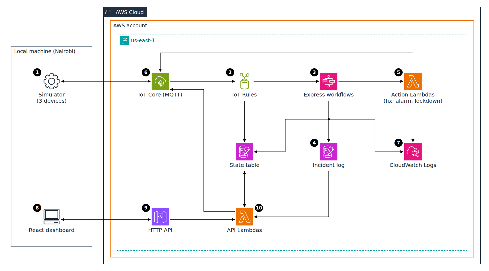

The animation below is an illustration, not a live counter: the timings it shows were measured during the Phase 5 tests on 15 October 2026, in us-east-1, with the devices simulated in Nairobi.

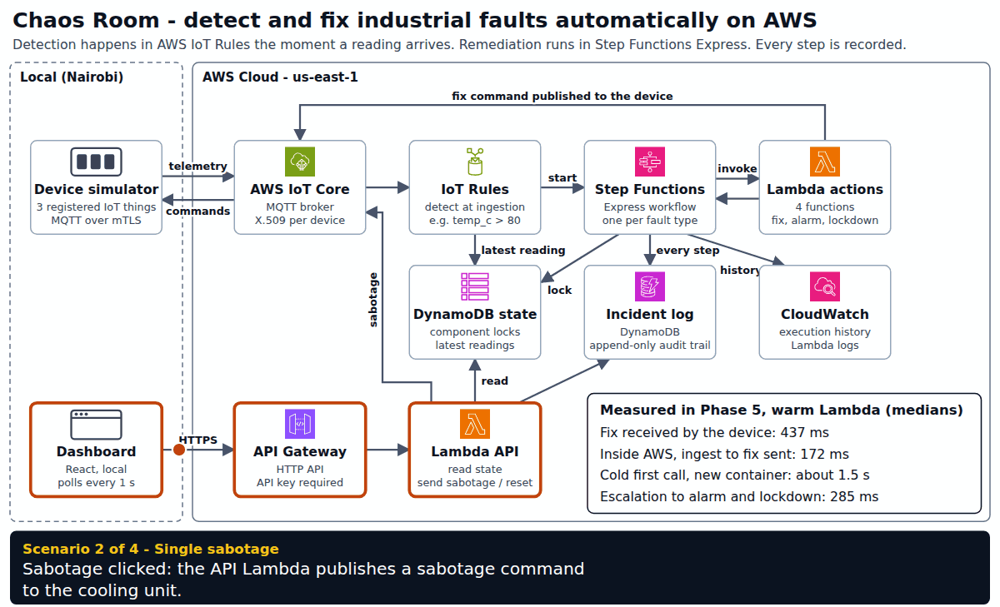

**Flow:** A simulated cooling unit in Nairobi publishes a reading every second to AWS IoT Core over MQTT, authenticated by its own X.509 certificate. When a saboteur overheats it, the next reading (92 °C) reaches IoT Core, where an IoT Rule (`temp_c > 80`) matches it at ingestion and starts a Step Functions Express workflow. The workflow takes a per-component lock in DynamoDB so repeated faulty readings do not open duplicate incidents, writes `DETECTED` to an append-only incident log, and invokes the `close_valve` Lambda, which publishes the fix command straight back to the device over IoT Core. The workflow then logs `REMEDIATED` and `RESOLVED` and releases the lock. If the valve reports that it did not close, the workflow takes the escalation path instead: it raises the plant alarm, engages lockdown, logs every step, and ends `FAILED`. A local React dashboard reads the live state and the log through API Gateway.

---

## Table of Contents

- [The Problem This Project Solves](#the-problem-this-project-solves)
- [What This Actually Is](#what-this-actually-is)
- [Tech Stack](#tech-stack)
- [The Build, in Order](#the-build-in-order)
- [Real Problems Hit and Fixed](#real-problems-hit-and-fixed)
- [Proof It Works](#proof-it-works)
- [Cost Discipline](#cost-discipline)
- [Running This Yourself](#running-this-yourself)
- [Architecture Decisions](#architecture-decisions)
- [Cleanup](#cleanup)

---

## The Problem This Project Solves

Industrial control systems, and cloud-connected IoT fleets in general, have a problem that request/response APIs never face: telemetry arrives continuously and out of order from many independent devices, and some of it demands an automated response within a fraction of a second. A valve has to close, power has to move to a backup feed, an alarm has to sound, and no human is fast enough to do it by hand.

Building that detect-and-react loop is easy to get almost right. The hard parts are the ones a demo usually skips: a faulty sensor keeps reporting the same fault every second until it is fixed, so detection has to open exactly one incident and not ten; a remediation action can itself fail, and the system must say so instead of reporting success; and an auditor needs a record of what the automation did, not an assumption that it worked. This project builds that loop on AWS and measures it, including the parts that went wrong.

## What This Actually Is

A simulated control room (a cooling unit, a power bus, an alarm system) whose faults are detected by AWS IoT Rules at ingestion and remediated by Step Functions Express workflows, implementing:

- **Detection at the edge of ingestion**: IoT Rules evaluate every reading as it arrives, with no database scan afterwards
- **Sub-second reactive orchestration**: one Express workflow per fault type, with Lambda actions that send the fix back to the device over MQTT
- **Exactly one incident per fault**: a conditional DynamoDB lock with a settle window absorbs the repeated faulty readings
- **An explicit escalation path**: a failed fix raises the alarm, engages lockdown and ends the execution `FAILED`
- **An append-only audit trail**: no principal in the stack can update or delete an incident log entry
- **Concurrent incidents**: two simultaneous faults run as two independent executions

Built in one working day (15 October 2026), from an empty AWS account to 100 measured incidents, then torn down the same day: all 74 resources destroyed and the account checked empty (see Cleanup).

## Tech Stack

| Layer | Technology |
|---|---|
| Infrastructure as Code | Terraform (remote state in S3 with native lockfile, bootstrap stack with local state) |
| Telemetry ingestion | AWS IoT Core (MQTT over mTLS, one X.509 certificate per device, CSR-signed) |
| Detection | AWS IoT Rules Engine (SQL rules per fault condition) |
| Orchestration | AWS Step Functions Express Workflows (JSONata, direct DynamoDB integration) |
| Remediation actions | AWS Lambda (Node.js 24, arm64), one function and one IAM role per action |
| Incident record and state | Amazon DynamoDB (append-only incident log, separate state table) |
| Observability | Amazon CloudWatch (Express execution history, Lambda logs, IoT metrics) |
| Dashboard API | Amazon API Gateway HTTP API, two Lambdas, API key on every route |
| Dashboard | React, Vite, Tailwind CSS, run locally |
| Device simulation | Node.js, mqtt.js, three registered IoT things |
| Security | IAM least privilege per function and per workflow, IoT policy scoped with policy variables |
| Testing | CLI scenario driver, Playwright (headless Chromium) end-to-end run |

## The Build, in Order

**1. Budget first.** A 5 USD monthly AWS Budget with credits and refunds excluded, created before any other resource. With promotional credits in the account, a credit-inclusive budget would not count the spend the credits absorb, and would never fire.

**2. Terraform backend.** A versioned, encrypted S3 state bucket with public access blocked and a TLS-only policy. State locking uses the S3 native lockfile (`use_lockfile = true`) instead of the DynamoDB lock table in the original plan, since DynamoDB locking is deprecated in Terraform's S3 backend.

**3. Device registration.** Three IoT things, each with an X.509 certificate signed from a locally generated CSR, so no private key ever enters Terraform state. One IoT policy uses policy variables: a device can only connect as itself, publish its own telemetry and receive its own commands. Negative tests confirm a device cannot publish to another device's topic or impersonate another thing.

**4. Simulator.** A local Node.js process that acts as the three devices and publishes one reading per second each. Readings never carry a fault flag: detection has to come from the values alone.

**5. Detection and remediation.** Two IoT Rules (`temp_c > 80`, `load_pct > 100 OR voltage_v < 207`) start two Express workflows. Each workflow locks its component, logs, invokes its action Lambda, logs again and releases the lock, or escalates through `raise_alarm` and `lockdown` when the action fails. The workflows write the audit log through the direct DynamoDB integration, so there is no extra Lambda on the latency path.

**6. Failure injection.** The escalation scenario is triggered by a flag in the state table that makes the action Lambda report a stuck actuator (`ValveDidNotClose`, `TransferSwitchFailed`). The workflow under test is unchanged.

**7. Dashboard API and dashboard.** A third IoT Rule mirrors the latest reading of each component into DynamoDB. An HTTP API exposes `GET /state` (read-only Lambda) and `POST /sabotage`, `POST /reset` (command Lambda). The Vite dev server proxies `/api` and adds the API key server-side, so the key never reaches the browser.

**8. A narrow auto-apply rule.** During the dashboard and measurement phases, `terraform apply` ran without a manual approval only when the plan created nothing, destroyed nothing and changed nothing but the code (`source_code_hash`) of `chaos-room-*` Lambdas. A script (`infra/stack/check-code-only-plan.sh`) checks the plan JSON and was tested on a passing and a failing plan. Every other apply was approved by hand after reading the plan.

**9. Measurement.** 80 scripted runs from a clean state plus a 5-minute normal-operation window, with device-clock and AWS-clock figures kept separate.

**10. Diagram and documentation.** A self-contained animated diagram using unmodified icons from the official AWS Architecture Icons package.

## Real Problems Hit and Fixed

Everything below happened during the build and is recorded in `docs/DEVLOG.md`.

**Every sabotage opened two incidents instead of one.** The first design released the component lock when the workflow finished, assuming that meant the device was fixed. It did not: the fix command still needs about 300 ms to travel from us-east-1 to the device in Nairobi, and a faulty reading published 469 ms after the fault, before the fix arrived, reached AWS after the lock was released and opened a second incident. The lock now records `reopen_after = now + 1.5 s`, and a reading opens a new incident only if it was ingested after that. A fault that persists is still caught on the next reading. After the fix, 100 incidents out of 100 opened exactly once.

**A negative security test passed for the wrong reason.** The IoT policy test reported PASS for "publish on own command topic is denied", but the log showed `connect refused`, not `publish rejected`. The test reused the running simulator's client ID; IoT Core allows one connection per client ID, and the simulator reconnected and kicked the test client out before it could publish. With the simulator stopped, every case failed at the expected step.

**The fix was faster than the dashboard could show it.** A warm remediation takes about 170 ms inside AWS, and the dashboard polls once per second, so a viewer often saw a tile go from healthy to healthy. A resolved incident now stays on its tile for 8 seconds ("Fault detected and fixed in N ms"). The browser test also caught the read model showing "fix failed" during normal remediations and a `FAULT` flash inside the settle window; both were read-model bugs, fixed before any recording.

**"Warm" figures that were not warm-only.** The first Phase 5 summary and diagram presented 445 ms and 173 ms as warm medians. They were the medians of all 40 runs, including 2 cold first calls. The warm-only medians are 437 ms and 172 ms; caught while recomputing the split for this README.

**Concurrent incidents did not always overlap in time.** In 2 of 20 concurrent runs the two Step Functions executions did not overlap. The two sabotage commands are separate MQTT messages from Nairobi; in those runs they arrived 146 ms and 156 ms apart, while a warm execution lasts about 100 to 160 ms. Each incident still had its own execution and its own lock, with no interference. Reported as measured: 18 of 20 runs overlapped.

**A component in lockdown starts one workflow per second.** After an escalation, the device keeps publishing faulty readings and the IoT Rule keeps starting executions, which stop at the lock (`SuppressedDuplicate`). One session left the cooling unit in lockdown; the console then listed 817 cooling executions over 3 hours, the visible ones all 15 to 40 ms suppressed duplicates. This is the intended behavior (no duplicate incidents, nothing written to the audit log), and every scripted run now starts with a reset and a check that no lock is left.

**Verification scripts that lied.** A lock check reported `STILL PRESENT` for an item that did not exist, because `--output text` prints `None` and `grep -q .` matched it. A 5-minute wait ended instantly because `date +%s%3N` printed nanoseconds on this Ubuntu image. CloudWatch showed 120 IoT messages for a minute that really had 180, because the minute was still being aggregated. Each was caught by cross-checking against a second source.

**Smaller ones.** A Step Functions definition was rejected because of unescaped quotes inside a JSONata expression in the JSON template. Headless Chromium could not start in WSL until `libnss3`, `libnspr4` and `libasound2t64` were installed.

## Proof It Works

A single sabotage on the cooling unit runs the full loop: rule match, lock, `DETECTED`, `close_valve`, `REMEDIATED`, `RESOLVED`.

```bash
cd simulator
npm start                        # terminal 1: the three devices
npm run scenario -- single cooling   # terminal 2
```

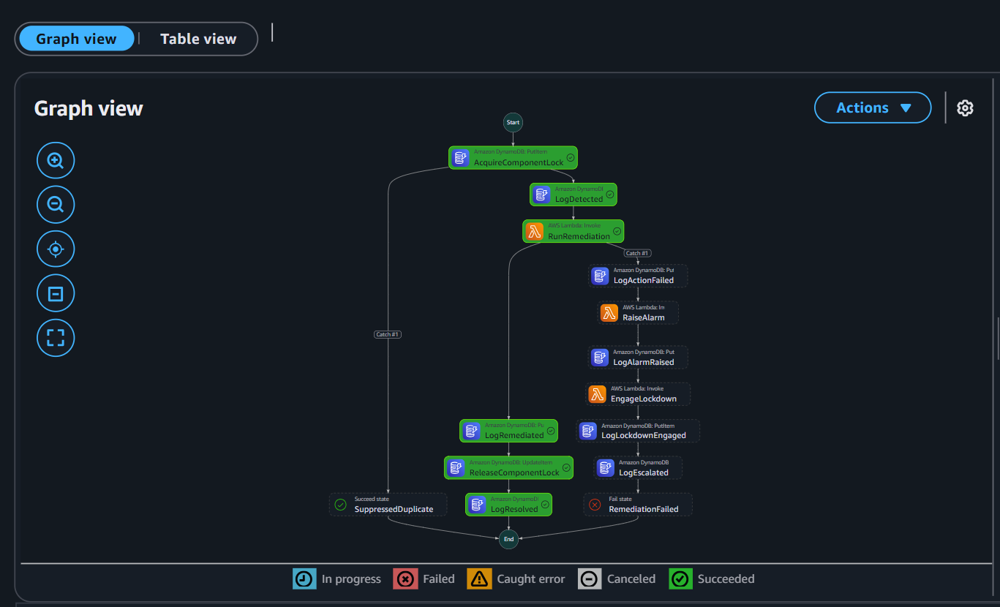

The same incident on the dashboard (automated Playwright capture):

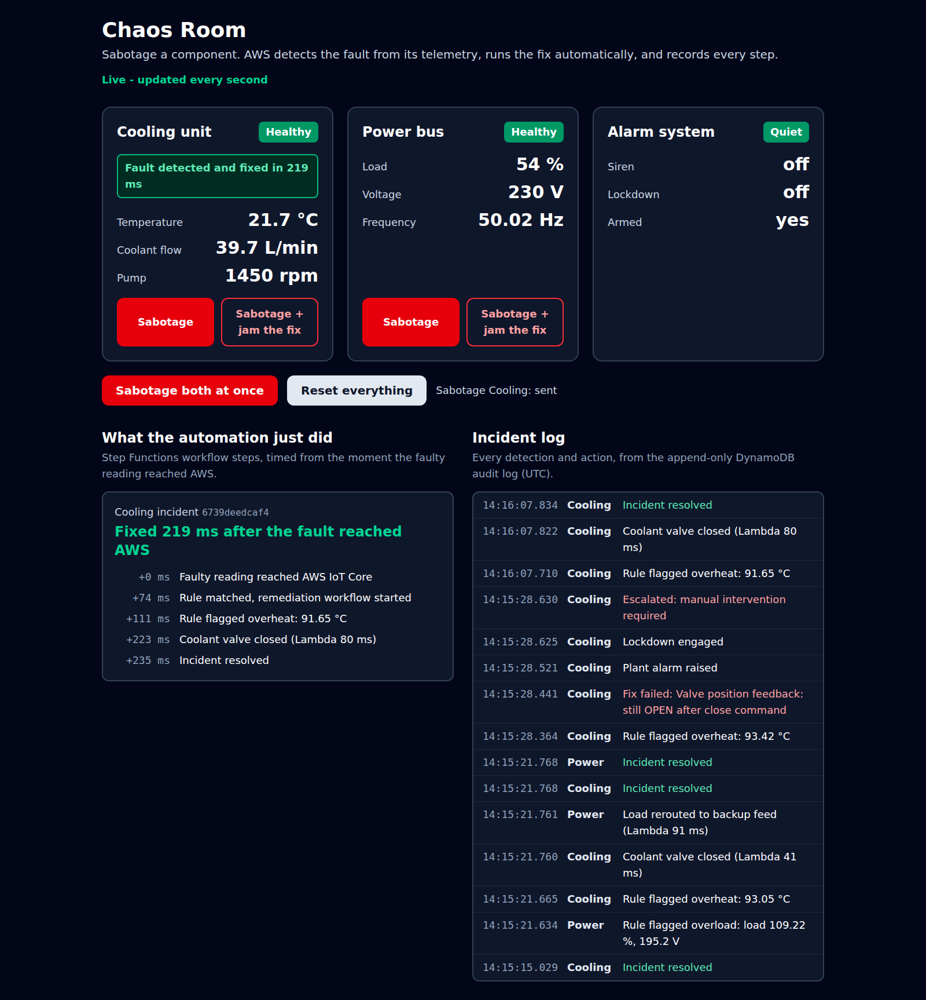

When the fix fails, the workflow escalates and the execution ends `FAILED` instead of reporting success.

```bash
npm run scenario -- escalation cooling
```

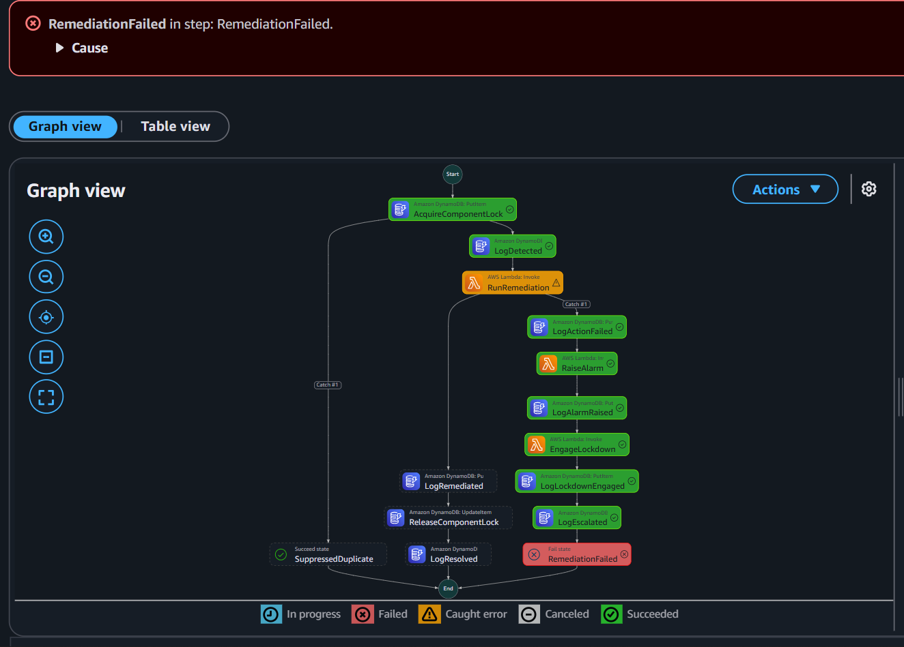

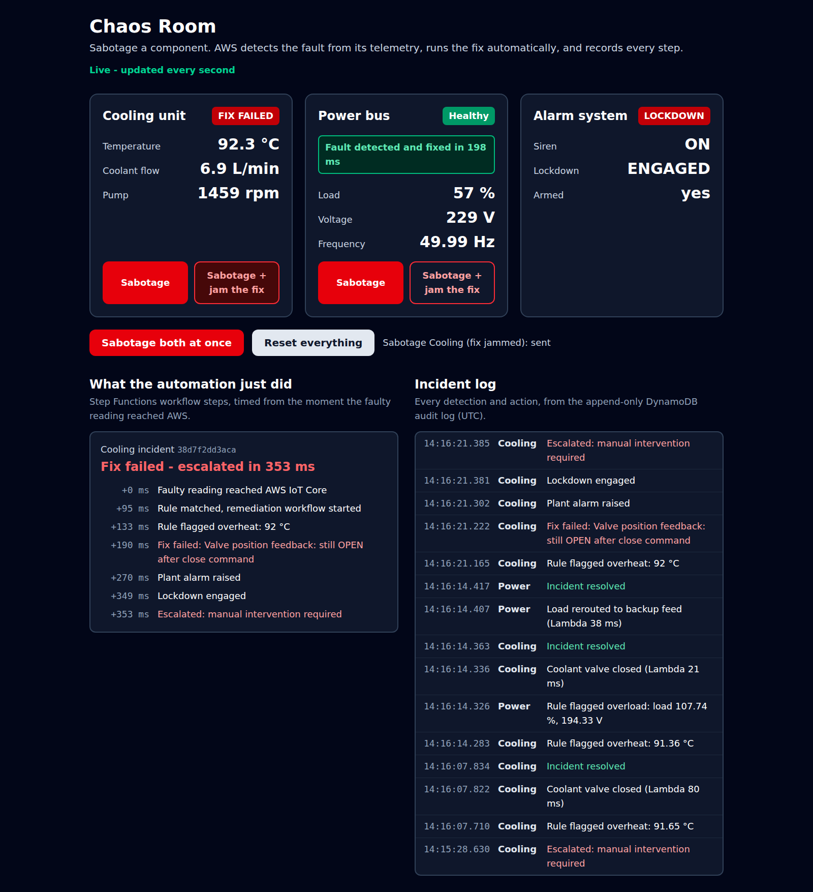

Two components sabotaged at the same time run as two independent executions.

```bash
npm run scenario -- concurrent
```

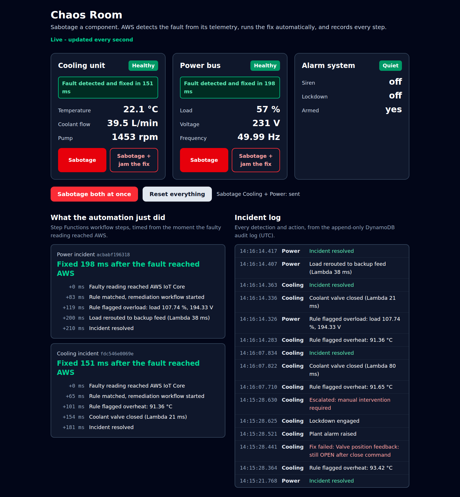

Latency was measured over 80 scripted runs (15 October 2026, us-east-1, devices simulated in Nairobi), each starting from a clean state. Two clocks are never mixed: the device clock measures from the moment the simulator published the faulty reading to the moment it received the fix command, which includes the network round trip between Nairobi and us-east-1; the AWS side measures from IoT Core's ingest timestamp to the moment the action Lambda finished sending the fix. "Cold" means the first call on a new Lambda container.

```bash
npm run scenario -- measure single cooling 20
npm run scenario -- measure single power 20
npm run scenario -- measure concurrent - 20
npm run scenario -- measure escalation cooling 10
npm run scenario -- measure escalation power 10
node summarize.mjs
```

| Measurement | Runs | Min | Median | Max |
|---|---|---|---|---|
| Single sabotage, device clock, warm | 38 | 370 ms | 437 ms | 621 ms |
| Single sabotage, device clock, cold | 2 | 1475 ms | 1507 ms | 1538 ms |
| Single sabotage, AWS ingest to fix sent, warm | 38 | 97 ms | 172 ms | 313 ms |
| Single sabotage, AWS ingest to fix sent, cold | 2 | 1205 ms | 1248 ms | 1290 ms |
| AWS ingest to workflow started (rule latency) | 40 | 42 ms | 76 ms | 140 ms |
| Concurrent, device clock (all warm) | 40 | 403 ms | 446 ms | 700 ms |
| Concurrent, AWS ingest to fix sent (all warm) | 40 | 123 ms | 180 ms | 311 ms |
| Escalation, AWS ingest to alarm and lockdown, warm | 19 | 189 ms | 285 ms | 358 ms |
| Escalation, AWS ingest to alarm and lockdown, cold | 1 | 1790 ms | 1790 ms | 1790 ms |

Warm remediation is sub-second on both clocks; a cold first call is not (about 1.5 s on the device clock). Exactly one incident per sabotage in 100 of 100 incidents. In normal operation, 5 minutes with the simulator running produced 180 messages per minute, 0 incidents and 0 workflow executions. Raw data and summaries: `proof/24` to `proof/27`.

The incident log in DynamoDB, one row per step:

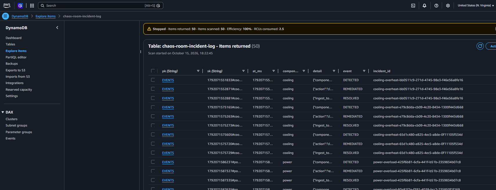

The device policy denies everything a device does not need, checked with negative tests:

```bash
node simulator/policy-test.mjs
# PASS | own identity, own topic              | publish accepted
# PASS | own identity, other device topic     | publish rejected (connection closed by broker)
# PASS | impersonate other thing              | connect refused (connection closed by broker)
# PASS | publish on command topic             | publish rejected (connection closed by broker)
```

The dashboard API key is not in any commit or tracked file. The key was searched for without being printed:

```bash
git grep -cF "$KEY" $(git rev-list --all) -- | wc -l     # 0 matching files
git log --all -p | grep -cF "$KEY"                        # 0 matching lines
git check-ignore -v dashboard/.env.local                  # .gitignore:18:.env.*
```

A control search for a string known to be committed (`use_lockfile`) returned matches, so the zero is a real zero.

The deployed resources, from the CLI:

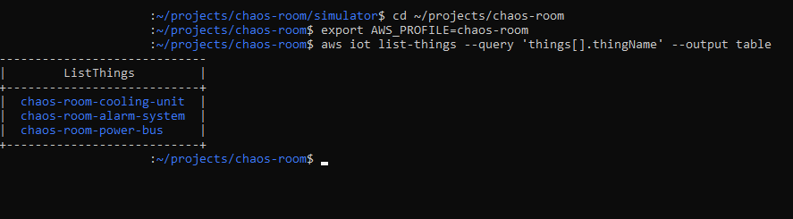

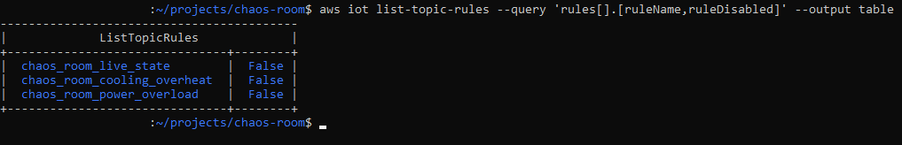

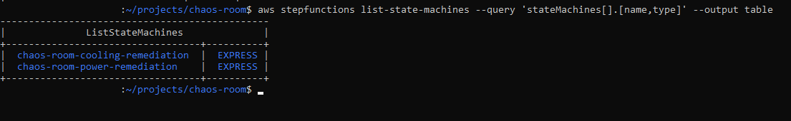

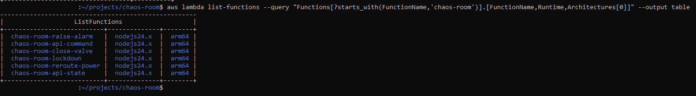

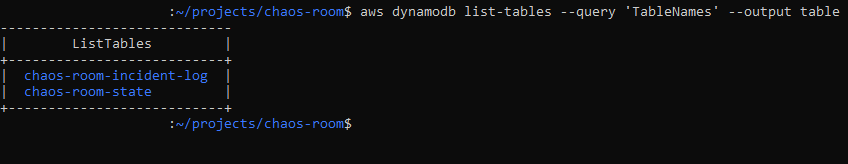

The build history, one commit per phase (`git log --oneline` at teardown, 15 October 2026):

```text
e0803dd Phase 7: teardown and verification
3be733f Add budget and MQTT telemetry captures
43a8bef Phase 6: README, corrected diagram and GIF
0d2f566 Phase 6: animated architecture diagram and static PNG
a50b786 Phase 5: demo validation, latency measurements, console captures
e347a2d Phase 4: dashboard API and React control room
81249ed Phase 3: detection rules, Express remediation workflows, incident log
2b9a92d Phase 2: IoT Core registration, device policy, telemetry simulator
db7d2a4 Phase 1: Terraform backend, budget alert, repo skeleton
```

## Cost Discipline

The stack used only pay-per-use services: no NAT Gateway, no EC2, no always-on resource.

A 5 USD monthly AWS Budget was the first resource created, with credits and refunds excluded so that promotional credits cannot hide real spend. The budget page shows the limit and the excluded charge types:

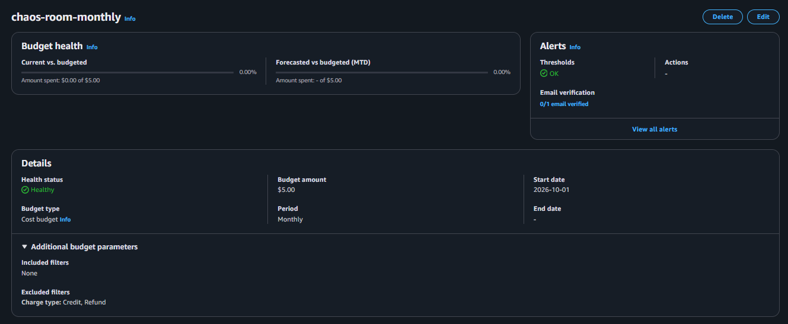

The same page showed "0/1 email verified": the alert e-mail subscription was never confirmed, so an alert would probably not have been delivered. The budget was in place, but its alert was not a working safety net during the build.

Every resource that supports tags carried `Project=chaos-room` through the Terraform provider's default tags (`proof/03-budget-and-state-bucket-verification.txt`). IoT things and certificates cannot be tagged, so the teardown check lists them by name.

On 15 October 2026, the day of the build, the main stack (67 resources) and then the bootstrap stack (7 resources) were destroyed, and every check came back empty:

```bash
aws resourcegroupstaggingapi get-resources --tag-filters Key=Project,Values=chaos-room
# []
aws iot list-things          # no chaos-room thing
aws iot list-certificates    # 0 certificates
aws s3api head-bucket --bucket chaos-room-tfstate-<account-id>
# An error occurred (404) when calling the HeadBucket operation: Not Found
```

The same empty result for Lambda functions, DynamoDB tables, state machines, log groups, APIs, IAM roles and the budget is in `proof/29-teardown-verification.txt`.

## Running This Yourself

Requirements: AWS CLI v2, Terraform >= 1.10, Node.js 24, OpenSSL, an AWS account.

```bash
# 0. Use a dedicated AWS CLI profile
export AWS_PROFILE=chaos-room

# 1. Budget alert and Terraform state bucket (local state for this bootstrap stack)
cd infra/backend
echo 'budget_email = "you@example.com"' > terraform.tfvars
terraform init && terraform apply

# 2. Device keys and CSRs, generated locally (private keys never leave the machine)
cd ../../simulator
npm install && npm run gen-keys

# 3. IoT Core, rules, workflows, Lambdas, DynamoDB, API (state in the S3 bucket from step 1)
cd ../infra/stack
echo 'bucket = "chaos-room-tfstate-<account-id>"' > backend.hcl
terraform init -backend-config=backend.hcl
terraform plan -out=tfplan && terraform apply tfplan

# 4. Start the three simulated devices
cd ../../simulator
npm start

# 5. In a second terminal: run the scenarios from the CLI
npm run scenario -- single cooling
npm run scenario -- concurrent
npm run scenario -- escalation cooling
npm run scenario -- reset

# 6. Dashboard (the API URL and key were written to dashboard/.env.local by step 3)
cd ../dashboard
npm install && npm run dev       # open http://localhost:5173
```

## Architecture Decisions

**Step Functions Express over Standard.** The workload is high-volume, short-lived and latency-sensitive: a warm execution lasts about 100 to 160 ms. Express is priced and built for that; Standard is built for long-running, low-volume workflows.

**IoT Rules over a detection Lambda.** The rule engine evaluates each reading at ingestion with no code to run or scale, and keeps detection and remediation as two separately testable services.

**Rule-based thresholds over ML anomaly detection.** Every detection traces back to one readable SQL condition, which matters more than sophistication for an automated remediation path.

**A local simulator over a scheduled Lambda publisher.** EventBridge schedules run at most once a minute and would bypass device registration. The local process exercises the real path (thing, certificate, scoped policy) and runs only while it is started. The Lambda in the sabotage path is the API command function.

**A settle window over releasing the lock at remediation time.** Releasing the lock as soon as the fix was sent produced a duplicate incident per run. Keeping the incident open for 1.5 s after the fix covers readings already in flight.

**An append-only log table plus a separate state table over a single table.** The audit log only ever receives conditional `PutItem`; locks, live readings and failure injection live in a second table, so no role needs `UpdateItem` or `DeleteItem` on the log.

**Device-clock latency over cross-clock subtraction.** The local clock and AWS clocks only agree to about a second, so a device timestamp minus an AWS timestamp is not a trustworthy millisecond figure. Each measurement uses a single clock.

**CSR-signed certificates over AWS-generated keys.** Private keys stay on the machine and never appear in Terraform state.

**HTTP API with the key checked in the Lambdas over a REST API usage plan.** HTTP APIs have no native API keys; a constant-time check in each function plus throttling meets the requirement with fewer resources, and the Vite proxy keeps the key out of the browser.

**S3 native state locking over a DynamoDB lock table.** Same guarantee, one fewer resource to secure and remove, and DynamoDB locking is deprecated in Terraform's S3 backend.

**Polling over WebSockets for the dashboard.** One request per second is enough for a local demo and needs no connection management. The tradeoff is the fix being faster than the poll, handled by keeping the result on screen.

## Cleanup

```bash
# 1. Main stack: IoT, rules, workflows, Lambdas, DynamoDB, API
cd infra/stack && terraform destroy

# 2. Bootstrap stack last: budget and state bucket (force_destroy removes all object versions)
cd ../backend && terraform destroy

# 3. Verify nothing tagged is left (IoT things and certificates cannot be tagged, so check them directly)
aws resourcegroupstaggingapi get-resources --tag-filters Key=Project,Values=chaos-room
aws iot list-things
aws iot list-certificates
```

Run on 15 October 2026: 67 resources destroyed in the main stack, then 7 in the bootstrap stack, with no error. Every check came back empty: no resource tagged `Project=chaos-room`, no IoT thing, certificate, policy or rule, no Lambda, DynamoDB table, state machine, log group, API, IAM role or budget left, and the state bucket returns 404. Output in `proof/28-teardown-destroy.txt` and `proof/29-teardown-verification.txt`.
